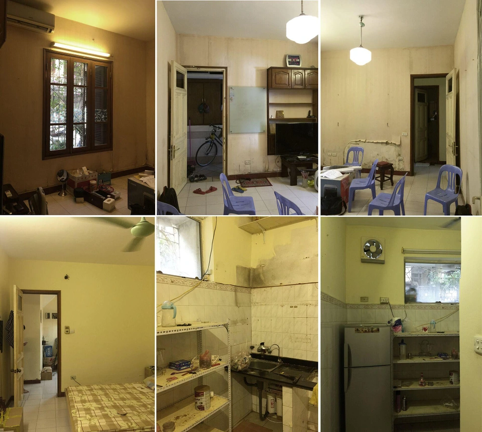

# Căn 1305 — định hướng nội thất

Ảnh do người dùng cung cấp ngày 16/11/2026 được chọn làm reference chính cho nội thất căn 1305. Chưa xác minh tác giả, địa điểm hoặc quyền sử dụng; dùng để tham khảo và dựng assets mới.

## Những đặc điểm cần giữ

- Căn hộ bình dân nhỏ, có dấu sinh hoạt thật, không phải nội thất mới cải tạo.
- Tường vàng kem cũ, loang ẩm và bong sơn cục bộ; nền gạch vuông sáng, mạch gạch rõ.
- Cửa gỗ sơn trắng ngà, khung gỗ sẫm; cửa sổ gỗ có song sắt và đèn tuýp phía trên.
- Phòng sinh hoạt có bàn nhỏ, ghế nhựa xanh tím, tủ gỗ và đồ đạc không đồng bộ.
- Phòng ngủ đơn giản với đệm mỏng; bếp hẹp có gạch ốp cũ, chậu rửa inox, kệ sắt và quạt hút.
- Ánh sáng vàng trong nhà pha ánh sáng ngoài cửa sổ. Độ cũ thể hiện bằng chi tiết vật liệu, không phủ đen mọi bề mặt.

## Bố cục đề xuất cho game

Ảnh là sáu góc nhìn, không đủ để xác định mặt bằng thật. Bố cục dưới đây là phương án hư cấu phục vụ game:

1. Cửa vào dẫn tới phòng sinh hoạt, thấy bàn ghế và cửa sổ. Đây là cảnh chính căn 1305.
2. Một cửa bên trong dẫn tới phòng ngủ nhỏ; giữ tầm nhìn hẹp qua khuôn cửa để dùng cho hiện tượng bóng người.
3. Bếp nằm phía sau hoặc bên cạnh, có cửa sổ và quạt hút. Chốt vị trí trên sơ đồ trước khi dựng các góc camera.
4. Ô giấu sách là ô kỹ thuật có nắp tháo được trên một vách ngăn phía trong. Chi tiết này được thiết kế thêm, không phải thứ đã được xác nhận trong ảnh.

## Các điểm tương tác

- Bàn nhỏ: giấy hoặc vật dụng cho thấy Khánh và Lan từng gặp nhau ở đây; cần viết nội dung riêng, không đặt thư tiết lộ cuối truyện tại đây.
- Cửa sổ: xem song sắt, bụi và ánh sáng; giúp định hướng không gian.
- Khuôn cửa phòng ngủ: quan sát một bóng thoáng qua sau khi đạt điều kiện tiến trình.
- Vách gần ô kỹ thuật: vết bụi đứt đoạn hoặc đầu vít mới hơn phần còn lại dẫn sự chú ý tới nắp.
- Ô kỹ thuật: trạng thái đóng, mở và đã lấy sách; xác định kích thước để cuốn sách thực sự đặt vừa.

Quạt hút trong ảnh là reference tốt cho vật liệu và âm thanh, nhưng không mặc định là chỗ giấu sách. Không yêu cầu người chơi chạm vào thiết bị đang chạy để lấy đồ.

## Chuyển sang căn hộ đã bỏ trống nhiều năm

Giữ nguyên tỷ lệ, vật liệu và vẻ bình dân của ảnh. Bớt đồ tiêu hao còn mới, dọn bớt ghế, thêm bụi và một vài dấu tích sửa chữa. Giữ lại ít đồ có ý nghĩa thay vì rải đồ vật lên mọi bề mặt. Không tự thêm đồ cúng hoặc biểu tượng giáo phái nếu truyện chưa có lý do.

## Biến thể kinh dị

- Cảnh cơ sở: ghế quay về bàn, cửa phòng ngủ khép hờ, đèn tuýp hoạt động.
- Sau manh mối: một ghế đổi hướng nhìn về cửa phòng ngủ.
- Khi kiểm tra vách: tiếng gõ phát ra từ ô kỹ thuật; có dấu hiệu hình ảnh tương đương nếu tắt âm.
- Sau khi lấy sách: bóng người xuất hiện thoáng qua khuôn cửa, rồi biến mất khi quan sát lại.

Tất cả biến thể giữ nguyên bố cục và góc máy. Đây là đề xuất thiết kế, chưa phải assets đã sản xuất.

## Assets cần tạo từ reference

- Một cảnh phòng sinh hoạt chính; một cảnh phòng ngủ; một cảnh bếp nếu cần cho câu đố.
- Hình cận vách và nắp ô kỹ thuật đóng/mở/đã lấy sách.
- Sách đỏ và trang giấy bên trong.
- Các lớp riêng cho cửa, ghế, ánh đèn và bóng người để đổi trạng thái mà không vẽ lại căn phòng.

Ưu tiên reference này hơn ảnh căn hộ sau cải tạo trong web-reference.md khi có khác biệt về nội thất.
